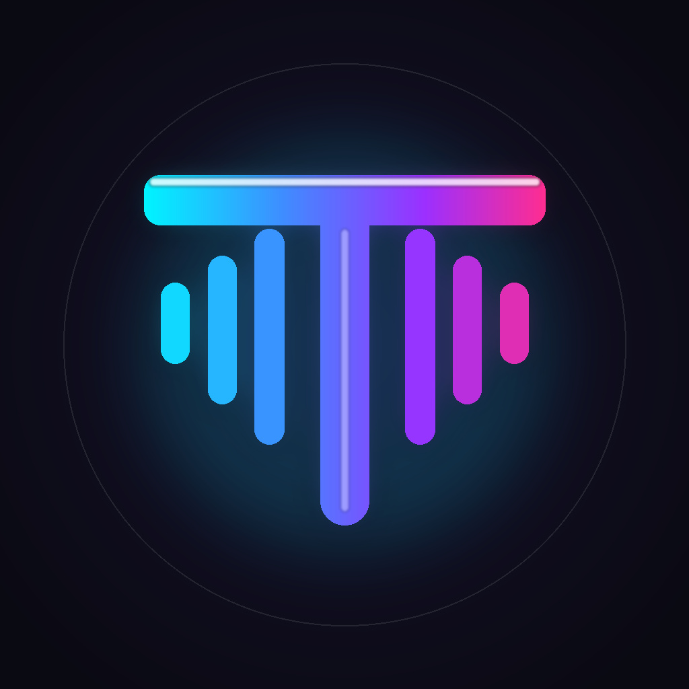
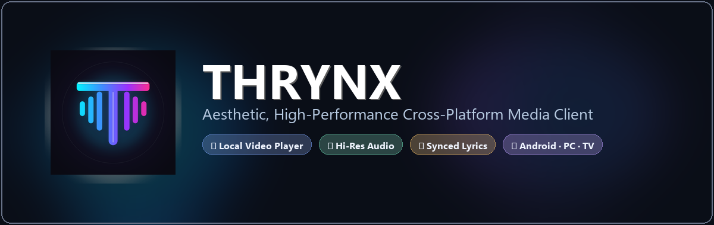

<div align="center">

<br/>



# THRYNX

### Aesthetic, High-Performance Cross-Platform Media Client

<br/>

[](https://github.com/sobuj-here/thrynx/releases)
[](https://github.com/sobuj-here/thrynx/blob/main/LICENSE)
[](#platforms--downloads)
[](https://github.com/sobuj-here/thrynx/releases)

<br/>

[**Overview**](#overview) · [**Features**](#features) · [**Platforms & Downloads**](#platforms--downloads) · [**Android Architecture Guide**](#which-android-apk-should-i-download) · [**PC & Web Client**](#using-thrynx-on-pc--desktop) · [**Installation**](#installation--sideloading) · [**Building**](#building-from-source) · [**Credits & Upstream**](#credits-and-acknowledgments) · [**License**](#license)

<br/>

</div>

> [!IMPORTANT]
> **THRYNX** is an independent, community-driven media player. It is not affiliated with, endorsed by, or connected to Google LLC, YouTube, Deezer, Spotify, or any of their subsidiaries.

---

<div align="center">
  

<br/><br/>

### ⚡ Direct Download — Latest Release (`v1.2.1`)

[-2563eb?style=for-the-badge&logo=android&logoColor=white)](https://github.com/sobuj-here/thrynx/releases/latest/download/app-prod-arm64-v8a-release.apk)
&nbsp;
[-ef4444?style=for-the-badge&logo=android&logoColor=white)](https://github.com/sobuj-here/thrynx/releases/latest/download/tv-prod-universal-release.apk)
&nbsp;
[-10b981?style=for-the-badge&logo=android&logoColor=white)](https://github.com/sobuj-here/thrynx/releases/latest/download/app-prod-universal-release.apk)
<br/>
[-f59e0b?style=for-the-badge&logo=android&logoColor=white)](https://github.com/sobuj-here/thrynx/releases/latest/download/app-prod-armeabi-v7a-release.apk)
&nbsp;
[-8b5cf6?style=for-the-badge&logo=googlechrome&logoColor=white)](https://github.com/sobuj-here/thrynx/releases/latest/download/app-prod-x86_64-release.apk)

<br/>

<sub>One-click direct download. All files are digitally signed and verified production builds.</sub>

</div>

<br/>

## <a id="overview"></a>Overview

**THRYNX** is an aesthetic, modern media client designed for audiophiles, media enthusiasts, and everyday listeners. Built with **Jetpack Compose** and **Kotlin Multiplatform**, THRYNX brings together seamless streaming, local music, an integrated local video player with gesture and zoom controls, dynamic Material You theming, synchronized animated lyrics, and rich ecosystem connectivity across mobile, desktop, TV, and smartwatches.

---

## <a id="features"></a>Features

<table>
  <tr>
    <td width="50%" valign="top">

### 🎬 Local Video Player `v1.2.1`
- **Fit-to-Screen Aspect Ratio Engine**: Zero stretching in portrait mode and zero unwanted cropping/zoom in landscape mode; pristine letterbox/pillarbox alignment.
- **Dual Audio & Multi-Audio Tracks**: Seamless in-player language switching for multi-track videos (Hindi, English, Bengali, 5.1 surround, etc.).
- **Subtitles & Captions Selection**: Real-time internal subtitle chooser with quick toggle.
- **In-App File & Folder Deletion**: Permanently delete single or multiple videos and entire folders directly from device storage (Android 10–15+ Scoped Storage compliant).
- **Resume Playback & Progress Indicators**: Remembers exact watch positions across restarts, with visual progress bars on video thumbnails.
- **Recently Played Highlight**: The last played video is highlighted in vibrant blue for instant recognition.
- **Pinch-to-Zoom & Pan**: Fluid two-finger pinch gesture with **1.0× to 4.5× smooth scaling and panning**.
- **MX Player-Style Gestures**:
  - Vertical swipe on the **left side** adjusts screen brightness.
  - Vertical swipe on the **right side** adjusts audio volume.
  - Horizontal drag to scrub with timestamps (`+0:45` / `-0:20`).
  - **Double-tap** left or right edge to skip 10 seconds backward or forward.
- **Fullscreen HUD & Controls**: Live device battery percentage, charging state, system clock, orientation lock, touch-lock, and dynamic Picture-in-Picture (PiP).

### 🎵 Audiophile Playback Engine
- **Streaming & Fallback**: Search, browse, and stream media with YouTube Music integration.
- **Hi-Res Lossless Audio**: Support for FLAC/ALAC lossless audio sources.
- **Gapless Playback & Crossfade**: Smooth track transitions with customizable crossfade (0–12s).
- **Automix [Beta]**: DJ-style intelligent transitions featuring tempo matching and beat alignment.
- **Offline Library**: Download tracks with embedded high-resolution artwork and metadata.
- **Background Media Playback**: Persistent foreground media session ensuring uninterrupted listening with screen locked or app minimized.
- **Bit-Perfect USB Exclusive Output**: Directly streams bit-perfect audio to external USB DACs without Android system resampling.
- **Fine Audio Controls**: Playback speed (0.5×–2.0×), skip silence, sleep timer, and system equalizer integration.

    </td>
    <td width="50%" valign="top">

### 🎤 Synchronized Lyrics & Visuals
- **Apple Music-Style Lyrics**: Fluid, word/syllable-level synchronized lyrics with kinetic animations.
- **Multi-Source Lyrics Providers**: Automated lookup across LRCLIB, Musixmatch, Genius, KuGou, Megalobiz, SimpMusic, and more.
- **Dynamic Theming**: Fluid Material You / Material 3 gradients generated dynamically from album art palettes.
- **Frosted-Glass UI**: Telegram-inspired translucent navigation bars and player controls powered by Haze.
- **Stats for Nerds**: Inspect codec, bit depth, sample rate, buffer health, and audio track details.

### 🌐 Ecosystem & Connectivity
- **Google Account Sign-In**: Synchronize your personalized playlists, subscriptions, and recommendations.
- **Spotify Integration**: Import and play your Spotify playlists and Liked Songs.
- **Discord Rich Presence**: Live playback status, album art, artist, and track timeline shown on your Discord profile.
- **Scrobbling Support**: Automatic scrobbling to **Last.fm** and **ListenBrainz**.
- **Cross-Device Availability**:
  - **Android Phones & Tablets** (Native Compose app).
  - **PC / Desktop & Web** (Vite + React 19 web player & companion browser extension).
  - **Android TV** (Leanback 10-foot living room UI).
  - **Wear OS** (Smartwatch companion for wrist control).

    </td>
  </tr>
</table>

---

## <a id="platforms--downloads"></a>Platforms & Downloads

THRYNX is designed for multi-platform flexibility. Check the table below to choose the right installation package for your device:

| Platform | Format / Type | Compatibility | Direct Download Link |
|:---|:---|:---|:---|
| 📱 **Android Phone & Tablet** | Signed `.apk` | Android 8.0 (Oreo) or higher | [⬇️ **Download ARM64 APK**](https://github.com/sobuj-here/thrynx/releases/latest/download/app-prod-arm64-v8a-release.apk) |
| 🌐 **Android Universal** | Signed `.apk` | All Android 8.0+ devices | [⬇️ **Download Universal APK**](https://github.com/sobuj-here/thrynx/releases/latest/download/app-prod-universal-release.apk) |
| 📱 **Android Legacy (32-bit)** | Signed `.apk` | Older 32-bit Android phones | [⬇️ **Download ARMv7 APK**](https://github.com/sobuj-here/thrynx/releases/latest/download/app-prod-armeabi-v7a-release.apk) |
| 💻 **PC Android Emulators / Intel** | Signed `.apk` | BlueStacks, LDPlayer, WSA, ChromeOS | [⬇️ **Download x86_64 APK**](https://github.com/sobuj-here/thrynx/releases/latest/download/app-prod-x86_64-release.apk) |
| 💻 **PC / Desktop & Web** | Web App + Extension | Windows, macOS, Linux (Chrome, Edge, Firefox, Brave) | [🚀 **Open Web Client Guide**](#using-thrynx-on-pc--desktop) |
| 📺 **Android TV** | Signed `.apk` | Google TV, Android TV boxes & sticks | [⬇️ **Download TV APK**](https://github.com/sobuj-here/thrynx/releases/latest/download/tv-prod-universal-release.apk) |
| ⌚ **Wear OS** | Wear OS Companion | Galaxy Watch, Pixel Watch, Wear OS 3+ | Integrated with phone app |

> 📥 **Need full changelog or older versions?** Visit the [**GitHub Releases**](https://github.com/sobuj-here/thrynx/releases) page.

---

## <a id="which-android-apk-should-i-download"></a>Which Android APK Should I Download?

When opening the Releases page, you will see multiple `.apk` assets. Use this guide to pick the best file for your device:

### 🟢 1. Modern Android Phones & Tablets (`arm64-v8a`) — Recommended
- **Direct Download:** [⬇️ **`app-prod-arm64-v8a-release.apk`**](https://github.com/sobuj-here/thrynx/releases/latest/download/app-prod-arm64-v8a-release.apk)
- **Who is this for:** **~95% of all Android users.** Any smartphone or tablet released in the last 7–8 years (including Samsung Galaxy, Google Pixel, Xiaomi, Redmi, OnePlus, Motorola, Nothing Phone, Vivo, OPPO, Realme, etc.).
- **Why choose it:** Smallest file size, fastest CPU execution, and best battery efficiency.

### 🌐 2. Universal Package (`universal`) — When in Doubt
- **Direct Download:** [⬇️ **`app-prod-universal-release.apk`**](https://github.com/sobuj-here/thrynx/releases/latest/download/app-prod-universal-release.apk)
- **Who is this for:** Users who are unsure of their device's processor architecture or experiencing compatibility issues.
- **Why choose it:** Contains native libraries for all CPU architectures bundled together. It installs and runs on any compatible Android device.

### 📱 3. Older 32-bit Android Devices (`armeabi-v7a`)
- **Direct Download:** [⬇️ **`app-prod-armeabi-v7a-release.apk`**](https://github.com/sobuj-here/thrynx/releases/latest/download/app-prod-armeabi-v7a-release.apk)
- **Who is this for:** Older Android phones, entry-level budget smartphones, or legacy devices running 32-bit ARM processors.

### 💻 4. PC Android Emulators & Intel Tablets (`x86_64`)
- **Direct Download:** [⬇️ **`app-prod-x86_64-release.apk`**](https://github.com/sobuj-here/thrynx/releases/latest/download/app-prod-x86_64-release.apk)
- **Who is this for:** Android emulators running on PC (e.g., **BlueStacks**, **LDPlayer**, **NoxPlayer**, **Windows Subsystem for Android**), or Chromebooks and tablets with Intel/AMD processors.

---

## <a id="using-thrynx-on-pc--desktop"></a>Using THRYNX on PC / Desktop

THRYNX offers two distinct methods for PC users (Windows, macOS, Linux):

### Option A: THRYNX Web Player & Browser Extension (Native Desktop Experience)
The repository includes a dedicated, lightweight modern Web client located in `web/app` built with **Vite**, **React 19**, **TypeScript**, and **Tailwind CSS v4**, complemented by a companion browser extension for Chromium (Chrome, Edge, Brave) and Firefox.

1. **Prerequisites**: Node.js 22 or newer (pnpm is bundled via Corepack).
2. **Install & Start**:
   ```bash
   corepack pnpm --dir web install
   corepack pnpm --dir web/app dev
   ```
3. Open `http://localhost:5173` in your browser.
4. **Companion Browser Extension**:
   Build the extension to enable background playback and external media key integration:
   ```bash
   corepack pnpm --dir web/extension build
   ```
   - In Chrome / Edge / Brave: Navigate to `chrome://extensions` → Enable **Developer mode** → Click **Load unpacked** → Select `web/extension/.output/chrome-mv3`.
   - In Firefox: Navigate to `about:debugging#/runtime/this-firefox` → Click **Load Temporary Add-on** → Select `web/extension/.output/firefox-mv3/manifest.json`.

### Option B: Android Emulator on Windows / macOS / Linux
If you prefer the mobile app interface on your desktop:
1. Install an Android emulator such as **BlueStacks**, **LDPlayer**, or **Windows Subsystem for Android (WSA)**.
2. Download the **`app-prod-x86_64-release.apk`** (or `app-prod-universal-release.apk`) from [Releases](https://github.com/sobuj-here/thrynx/releases).
3. Drag and drop the `.apk` file into your emulator to install and launch.

---

## <a id="installation--sideloading"></a>Installation & Sideloading

1. **Download the APK**: Download the appropriate APK (typically `app-prod-arm64-v8a-release.apk`) from [GitHub Releases](https://github.com/sobuj-here/thrynx/releases).
2. **Allow Installation**: Tap on the downloaded APK. If prompted by Android, grant **"Install unknown apps"** permission for your browser or file manager.
3. **Install**: Follow the on-screen prompts to complete the installation.
4. **Updating**: Future releases can be installed directly over your existing installation. Your settings, local cached tracks, and library preferences will be completely preserved.

---

## <a id="building-from-source"></a>Building from Source

### Prerequisites
- **JDK 17** or newer.
- **Android SDK** (API Level 35, Build-Tools 35.0.0).
- **Node.js 22+** (for web client).

### Build Android APKs
Clone the repository and compile the release binaries:
```bash
git clone https://github.com/sobuj-here/thrynx.git
cd thrynx

# Build production release APKs
./gradlew assembleProdRelease
```
The compiled APKs will be located in:
`app/build/outputs/apk/prod/release/`

### Build Web Client
```bash
corepack pnpm --dir web install
corepack pnpm --dir web/app build
```

---

## <a id="credits-and-acknowledgments"></a>Credits & Upstream Lineage

> [!NOTE]
> **THRYNX** is proudly built upon the open-source foundations of [**BitChord**](https://github.com/kushagrasinghx) (and its upstream project [**RiMusic**](https://github.com/fast4x/RiMusic)). We express our deepest gratitude and full credit to the original creators and contributors whose dedication and engineering made this incredible media player possible.

### 🌟 Upstream Foundations (BitChord & RiMusic)
The core music streaming architecture and baseline playback capabilities of THRYNX are inherited from the **BitChord** and **RiMusic** open-source codebases, including:
- **Audio Playback Engine:** YouTube Music integration, audio stream parsing, search and recommendation endpoints.
- **Audiophile DSP & Pipeline:** Hi-Res audio playback, smooth gapless transitions, customizable crossfade, and bit-perfect USB DAC support.
- **Synchronized Lyrics:** Word-by-word kinetic lyrics rendering inspired by Apple Music, with automated scraping across multiple lyric providers.
- **Ecosystem Connectivity:** Google account synchronization, Spotify playlist imports, Discord Rich Presence, and Last.fm / ListenBrainz scrobbling.
- **Glassmorphic UI Design:** Translucent frosted-glass bottom sheets and floating navigation bars powered by Haze and Jetpack Compose.

---

### 🚀 Enhancements & Features Added in THRYNX
Building upon the upstream foundations, THRYNX introduces new media capabilities, player controls, critical bug fixes, and customized multi-platform workflows:

1. **🎬 Integrated Local Video Player & Media Management (`v1.2.1`):**
   - **Fit-to-Screen & Aspect Ratio Engine (`v1.2.1`):** Precision video layout measurement preventing vertical stretching, squishing, or unwanted zoom in both portrait and landscape orientations.
   - **Dual Audio & Multi-Language Switching:** Full support for multi-audio MKV/MP4 files with one-tap language selection in the top control bar.
   - **In-App Storage File & Folder Deletion:** Complete media management allowing users to multi-select and permanently delete videos and folders from device storage using Android's `MediaStore.createDeleteRequest`.
   - **Playback Resume & Progress Bars:** Remembers exact watch positions across app restarts, with visual watch progress bars rendered on thumbnail cards.
   - **Hardware-Accelerated Thumbnails:** Fast asynchronous thumbnail loading paired with an in-memory `LruCache` for zero-lag 60fps scrolling.
   - **Fluid Pinch-to-Zoom & Pan:** 1.0× to 4.5× zoom gestures with automatic fit-to-screen reset on double tap or orientation change.
   - **MX Player-Style Touch Gestures:** Horizontal drag to seek, left-side vertical swipe for brightness, right-side vertical swipe for volume.
   - **Live HUD Display:** On-screen real-time battery indicator with charging status and system clock.
   - **Dynamic Picture-in-Picture (PiP):** Window aspect ratio dynamically matches the active video's portrait or landscape proportions.

2. **🛠️ Playback, Audio Focus & Fullscreen Improvements:**
   - **Audio Focus Management:** Background music automatically pauses when a local video is launched and resumes cleanly when closed.
   - **True Immersive Fullscreen:** Automatically hides Android system bars (Status & Navigation) and cleanly suppresses the music `MiniPlayer` and bottom tabs while playing video.
   - **Slider Scrubbing Fix:** Decoupled the periodic playback position update during touch interactions, ensuring the seek bar never snaps back or fights the user's finger.

3. **🎨 Visual Branding & Theme Overhaul:**
   - Custom **THRYNX** logo and complete suite of adaptive icons generated across all 5 mipmap densities (`mdpi`, `hdpi`, `xhdpi`, `xxhdpi`, `xxxhdpi`) for all 11 theme variants (Liquid Glass, Samsung Glass, Pixel Glass, Neon Silver/Cyan/Violet, and Monochrome).
   - Clean UI without residual naming conflicts.

4. **⚡ DevOps, Distribution & Direct Downloads:**
   - Automated GitHub Actions release pipeline building signed production APKs (`arm64-v8a`, `universal`, `armeabi-v7a`, `x86_64`) and multi-platform artifacts.
   - 1-click direct download infrastructure right from the README.

---

## <a id="disclaimer"></a>Disclaimer & Legal Notice

THRYNX is an independent, community-driven third-party media client. It is **not** affiliated with Google LLC, YouTube Music, Deezer, Spotify, Telegram, or any of their parent entities.

- **No Media Hosting**: THRYNX does not host, store, or distribute copyrighted media files. It functions strictly as a client interface to access local device storage or stream media directly through user-authenticated or publicly accessible endpoints.
- **Fair Use**: This software is intended strictly for personal research, educational, and fair-use purposes. Users remain entirely responsible for ensuring their usage complies with their jurisdiction's applicable laws and relevant platform terms of service.
- **Copyleft**: THRYNX is distributed as free software under the **GNU General Public License v3.0 (GPLv3)**. Any redistributed binaries or forks must be accompanied by corresponding source code under the same license terms.

---

## <a id="license"></a>License

THRYNX is distributed as free and open-source software under the **GNU General Public License v3.0 (GPLv3)**.

- **Freedom to Inspect & Modify:** You are free to run, inspect, modify, and redistribute this software.
- **Copyleft Guarantee:** Any derivative works or distributions must remain open source under the same GPLv3 license terms.
- **Attribution & Upstream Credit:** Preserves all original copyright notices and credits to the creators and contributors of BitChord, RiMusic, and THRYNX.

See the complete legal text in the [LICENSE](LICENSE) file.

<div align="center">
  <sub>Crafted for modern music & video playback.</sub>
</div>
