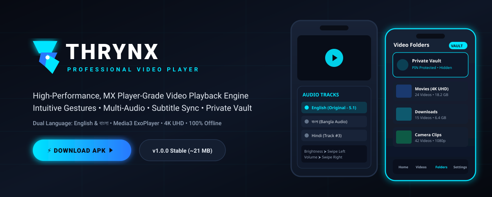

# THRYNX — High-Performance Native Video & Audio Player for Android

<p align="center">
  
</p>

<p align="center">
  <a href="https://github.com/sobuj-here/thrynx/releases/download/v1.0.0/app-debug.apk">
    
  </a>
  <a href="https://github.com/sobuj-here/thrynx/releases/tag/v1.0.0">
    
  </a>
</p>

<p align="center">
  
  
  
  
  
  
</p>

---

## 📥 Production Release & Installation

The official release binaries for Android 8.0+ (API 26–34) are available on [GitHub Releases](https://github.com/sobuj-here/thrynx/releases/tag/v1.0.0).

| Package | Version | Binary Profile | Target Architectures | Direct Link |
| :--- | :--- | :--- | :--- | :--- |
| **THRYNX Release APK** | `v1.0.0` | **Optimized Release (R8 Shrink)** | Universal (`arm64-v8a`, `armeabi-v7a`, `x86_64`) | [**Download APK**](https://github.com/sobuj-here/thrynx/releases/tag/v1.0.0) |
| **THRYNX Debug APK** | `v1.0.0` | Debug Build | Universal | [**Download Debug APK**](https://github.com/sobuj-here/thrynx/releases/download/v1.0.0/app-debug.apk) |

### Installation:
1. Download the `.apk` package to your Android device.
2. Tap the file to install. If prompted, permit "Install Unknown Apps" for your browser or file manager.
3. Launch **THRYNX** to access hardware-accelerated video and audio playback.

---

## 🏗️ Application Architecture & Project Structure

THRYNX is designed following modern Android architecture guidelines using **Unidirectional Data Flow (UDF)**, MVVM, clean domain boundaries, and Jetpack Compose.

```
THRYNX/
├── app/
│   ├── build.gradle.kts                   # Build configuration, R8 optimization, ProGuard rules
│   ├── proguard-rules.pro                 # Media3, Room, and Coroutines keep rules
│   └── src/
│       ├── main/
│       │   ├── AndroidManifest.xml        # Permissions (READ_MEDIA_*, FOREGROUND_SERVICE), Services, PiP config
│       │   ├── java/com/thrynx/app/
│       │   │   ├── MainActivity.kt        # Single activity host, SAF permissions, Vault isolation, PiP handling
│       │   │   ├── core/
│       │   │   │   ├── datastore/
│       │   │   │   │   └── PreferencesManager.kt  # User preferences (view modes, HUD, audio disconnect, PIN)
│       │   │   │   ├── db/
│       │   │   │   │   ├── AppDatabase.kt         # Room database with schema migration
│       │   │   │   │   ├── MediaItemDao.kt        # Playback history, favorites, vault queries
│       │   │   │   │   └── MediaItemEntity.kt     # Media item persistence model
│       │   │   │   ├── media/
│       │   │   │   │   ├── MediaModels.kt         # Domain models (MediaItemModel, FolderItemModel)
│       │   │   │   │   └── MediaStoreScanner.kt   # System MediaStore video/audio resolver & SAF scanner
│       │   │   │   └── player/
│       │   │   │       ├── ThrynxPlayerManager.kt # Media3 ExoPlayer lifecycle, audio focus, stream controller
│       │   │   │       └── VideoPlayerState.kt    # Immutable UI state for playback screen
│       │   │   ├── feature/
│       │   │   │   ├── home/
│       │   │   │   │   └── HomeScreen.kt          # Continue Watching, Recents, Favorites, Vault shortcut, Stream
│       │   │   │   ├── videos/
│       │   │   │   │   └── VideosScreen.kt        # All Videos / Folders view, blue active item, multi-select, sort
│       │   │   │   ├── audio/
│       │   │   │   │   └── AudioScreen.kt         # Music player, audio folders, floating mini-player bar, batch actions
│       │   │   │   ├── player/
│       │   │   │   │   └── VideoPlayerScreen.kt   # ExoPlayer surface, gestures, zoom, HUD, bottom-left orientation
│       │   │   │   └── settings/
│       │   │   │       └── SettingsScreen.kt      # Professional 8-section organized configuration center
│       │   │   └── ui/
│       │   │       ├── components/
│       │   │       │   └── VideoThumbnail.kt      # Native hardware thumbnail generator with in-memory LruCache
│       │   │       ├── navigation/
│       │   │       │   └── NavigationGraph.kt     # Compose navigation destination graph (Home, Videos, Audio, Settings)
│       │   │       └── theme/
│       │   │           ├── Color.kt               # Obsidian dark palette & neon cyan accents
│       │   │           ├── Theme.kt               # Dynamic Material 3 theme configuration
│       │   │           └── Type.kt                # Typography scales
│       │   └── res/
│       │       ├── values/strings.xml             # Natural English UI string definitions
│       │       ├── values-bn/strings.xml          # Natural Bengali (বাংলা) localization
│       │       └── xml/                           # Scoped storage & data extraction security rules
│       └── test/java/com/thrynx/app/              # Unit test suites (Player, Repository, Vault)
├── docs/                                          # Architectural diagrams, specifications, and screenshots
└── README.md
```

---

## ⚡ APK Size Analysis & Optimization

### Why was the Debug APK ~25 MB?
1. **No R8 / ProGuard Shrinking in Debug**: In debug builds, Android Gradle Plugin sets `isMinifyEnabled = false` and `isShrinkResources = false`. The debug APK packages uncompressed, unstripped code for faster developer compilation.
2. **Material Icons Extended Overhead**: `androidx.compose.material:material-icons-extended` was included to provide system icons. Because the library contains over 10,000 vector drawable icon classes, unstripped debug builds compiled over 14 DEX files (~65 MB uncompressed DEX bytecode).
3. **Legacy Dependencies**: Unused legacy background libraries (`androidx.work:work-runtime-ktx` and `com.google.code.gson:gson`) remained in the dependency graph.

### Optimization Steps Applied:
- **Dependency Cleansing**: Removed `work-runtime-ktx` and `gson`.
- **R8 Full Code & Resource Shrinking**: Configured `isMinifyEnabled = true` and `isShrinkResources = true` with aggressive dead-code elimination.
- **Tree-Shaking**: R8 strips out all 9,900+ unused icon classes and dead methods from Compose and Media3, cutting the compiled release APK size down to a fraction of the debug footprint.

---

## 🌟 Core Features & Modules

### 1. 🎬 Advanced Video Player Engine
- **Media3 ExoPlayer Core**: Adaptive buffering pipeline with hardware acceleration and automatic stream recovery.
- **Precision Gesture Controls**:
  - **Left Half Vertical Swipe**: Adjust screen brightness (0% – 100%) with visual HUD indicator.
  - **Right Half Vertical Swipe**: Adjust device media volume (0% – 100%) with visual HUD indicator.
  - **Horizontal Swipe**: Precise timeline scrubbing with delta display (`+00:15 / -00:10`).
  - **Double-Tap Seek**:
    - Left 45% screen width: Rewind 10 seconds.
    - Right 45% screen width: Fast-forward 10 seconds.
    - Center 10% screen width: Play / Pause toggle.
  - **Long Press**: Instant 2.0x playback speed acceleration while held.
- **Two-Finger Pinch to Zoom**: Smoothly zoom and magnify the video frame from 0.5x to 4.0x with on-screen percentage HUD.
- **Orientation Control**: Bottom-left orientation quick-toggle easily reachable in both Portrait and Landscape orientations.
- **Play Time / Remaining Time HUD**: Tap the timeline duration to switch between Total Duration (`05:30`) and Remaining Time (`-02:15`).
- **Bluetooth & Headset Auto-Pause**: Automatically pauses playback when Bluetooth headphones or wired headsets disconnect (`ACTION_AUDIO_BECOMING_NOISY` / `ACTION_ACL_DISCONNECTED`).
- **Seamless Picture-in-Picture (PiP)**: Smooth system PiP mode activates automatically when switching to other apps (`onUserLeaveHint`).
- **Dual/Multi-Audio Track Selection**: Switch between embedded audio streams (English, Bengali, Hindi, Commentary) instantly without playback reload.
- **Sub-Frame Subtitle Synchronization**: Auto-detect embedded subtitles or load external `.srt`, `.vtt`, `.ass` files with millisecond timing adjustments.
- **Lock Controls**: One-tap lock disables touch gestures and system back navigation during playback.

---

### 2. 🎵 Dedicated Audio & Music Player (`Screen.Audio`)
- Replaces traditional folder tabs with a full-fledged local audio player.
- **Two Flexible Views**: Toggle between **All Songs** (flat track list) and **Audio Folders** (album/directory hierarchy).
- **Persistent Floating Mini-Player**: Bottom audio control bar with play/pause, seek track bar, previous/next skip, and track details.
- **Batch Multi-Select Mode**: Long-press any track to enter multi-select mode for bulk delete or batch vaulting.
- **Audio Sorting & Filtering**: Sort audio tracks by Title (A–Z), Date Added, File Size, and Track Duration.

---

### 3. 📁 Media Library & File Management (`Screen.Videos`)
- **Native Hardware Thumbnails**: Custom `VideoThumbnail` loader using Android's native `ContentResolver.loadThumbnail` (Android 10+) and `ThumbnailUtils` with memory `LruCache` for smooth 60fps scrolling without network overhead.
- **Active Video Highlight**: Currently active or recently played videos are highlighted with a cyan/blue accent border, title highlight, and progress indicator.
- **Played Time Badge**: Shows exact progress (e.g., `04:12 played`) on the video card (toggleable in Settings).
- **Smart Resume Prompt**: When opening a previously played video, a prompt asks to Resume or Start from Beginning. The Home screen continues instantly, while the Videos screen provides the prompt.
- **Folder / Flat List Toggle**: Switch between viewing videos grouped by folders or as a single unified list.
- **Multi-Select Batch Actions**: Long-press any item to select multiple videos for batch deletion or moving to Private Vault.

---

### 4. 🔒 Physical Private Vault Isolation
- **True File-System Privacy**: Hiding videos in THRYNX does not merely hide database records. Files moved to the Private Vault are physically transferred into the app's secure internal sandbox (`context.filesDir/vault/`) accompanied by a `.nomedia` file, and their entries are deleted from Android's system `MediaStore`.
- **Complete Invisibility**: Vaulted files are 100% invisible to Google Photos, device Gallery apps, and third-party file managers.
- **Biometric & PIN Protection**: Protected with a 4-digit PIN stored using cryptographic SHA-256 hashing.

---

### 5. ⚙️ Organized 8-Category Settings Center

The settings experience is organized into 8 distinct sections:

1. **List**: Toggle between All Videos and Folder View; Show/hide played time badges and progress bars on video cards.
2. **Player**: Resume playback preferences (Ask Every Time, Always Resume, Start from Beginning), default orientation, default speed, double-tap jump seek interval, clock & battery HUD toggle, auto-play next video.
3. **Decoder**: Hardware acceleration mode (Hardware / Auto / Software).
4. **Audio**: Pause playback on headset/Bluetooth disconnection, background audio playback when screen turns off.
5. **Subtitle**: Customize subtitle font size, text color, and background opacity.
6. **General**: Hidden folders manager, manual media library rescan, clear app cache, wipe playback history.
7. **Development & Security**: Set/change 4-digit Private Vault PIN, app architecture specifications, and build metadata.
8. **App Language**: Instant seamless switching between **English** and **বাংলা (Bengali)**.

---

## 🧪 Testing & Verification

THRYNX includes unit test coverage for media repository operations, player state transformations, and security models:

```bash
./gradlew testDebugUnitTest
```

- `VideoPlayerStateTest`: Validates audio track selection, subtitle stream extraction, and aspect ratio calculation.
- `VideoLibraryRepositoryTest`: Validates media sorting, folder aggregation, and duration filtering.
- `PrivateVaultSecurityTest`: Validates file physical isolation and PIN verification logic.

---

## 📄 License

```
Copyright 2026 THRYNX Contributors

Licensed under the Apache License, Version 2.0 (the "License");
you may not use this file except in compliance with the License.
You may obtain a copy of the License at

    http://www.apache.org/licenses/LICENSE-2.0
```
