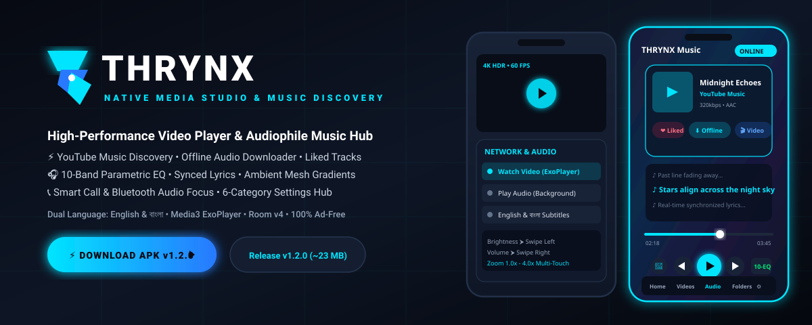

# THRYNX — High-Performance Native Video & Audio Player for Android

<p align="center">
  
</p>

<p align="center">
  <a href="https://github.com/sobuj-here/thrynx/releases/download/v1.1.0/THRYNX-v1.1.0.apk">
    
  </a>
  &nbsp;&nbsp;
  <a href="https://github.com/sobuj-here/thrynx/releases/tag/v1.1.0">
    
  </a>
</p>

<p align="center">
  
  
  
  
  
  
  
  
</p>

---

## 📥 Direct Download & Installation

Get the latest official APK build directly on your Android device:

<div align="center">

[](https://github.com/sobuj-here/thrynx/releases/download/v1.1.0/THRYNX-v1.1.0.apk)

</div>

### Installation Steps:
1. Tap the **Download APK** button above to download `THRYNX-v1.1.0.apk`.
2. Open the downloaded file in your browser or file manager.
3. If prompted, grant **"Install Unknown Apps"** permission.
4. Launch **THRYNX** to enjoy hardware-accelerated playback and high-fidelity audio.

---

## 🌟 Overview

**THRYNX** is a native, modern multimedia hub built with **Kotlin**, **Jetpack Compose (Material 3)**, and **AndroidX Media3 ExoPlayer**. 

Engineered for speed, privacy, and fluid responsiveness, THRYNX combines a feature-packed video player with an audiophile-grade music experience featuring a 10-band parametric equalizer, real-time synchronized scrolling lyrics, ambient album art backdrops, hardware-accelerated decoding, multi-track audio switching, and physical private vault isolation.

---

## 🏗️ Project Architecture & Directory Structure

THRYNX follows modern Android architectural standards (Unidirectional Data Flow, MVVM, and clean separation of concerns):

```
THRYNX/
├── app/
│   ├── build.gradle.kts                   # Dependencies, R8 code/resource shrinking, ProGuard config
│   ├── proguard-rules.pro                 # Media3, Room, and Coroutines keep rules
│   └── src/
│       ├── main/
│       │   ├── AndroidManifest.xml        # MediaStore permissions, AudioBecomingNoisy receiver, PiP config
│       │   ├── java/com/thrynx/app/
│       │   │   ├── MainActivity.kt        # Single activity host, SAF permissions, Physical Vault isolation, PiP
│       │   │   ├── core/
│       │   │   │   ├── database/          # Room database, HistoryDao, VideoDao, AudioDao, migrations
│       │   │   │   ├── datastore/         # PreferencesManager (DataStore key-value settings)
│       │   │   │   ├── designsystem/      # Theme, Color, Formatters, reusable UI components
│       │   │   │   ├── lyrics/            # LrcLibClient & synchronized lyric timestamp parsers
│       │   │   │   ├── media/             # MediaStoreScanner (SAF resolver, Scoped Storage deletion)
│       │   │   │   ├── model/             # Domain models (MediaItemModel, FolderItemModel, PlaybackState)
│       │   │   │   ├── player/            # ThrynxPlayerManager, EqualizerProcessor, EqCurve, PeakLimiter
│       │   │   │   └── service/           # ThrynxMediaPlaybackService (Foreground playback service)
│       │   │   ├── feature/
│       │   │   │   ├── home/              # HomeScreen (Continue Watching, Recents, Vault shortcut)
│       │   │   │   ├── videos/            # VideosScreen (List/Grid view, blue active item, multi-select)
│       │   │   │   ├── audio/             # AudioScreen, NowPlayingSheet, EqualizerSheet, ThinSlider
│       │   │   │   ├── folders/           # FoldersScreen (Directory hierarchy, multi-select folder delete)
│       │   │   │   ├── player/            # VideoPlayerScreen (Gestures, zoom 1.0x-4.0x, PiP, lock HUD)
│       │   │   │   └── settings/          # SettingsScreen (8 organized settings sections)
│       │   │   └── ui/
│       │   │       ├── components/        # VideoThumbnail with LruCache memory pool
│       │   │       └── navigation/        # NavigationGraph (Bottom bar, route destination mapping)
│       │   └── res/
│       │       ├── values/strings.xml     # Natural English UI string definitions
│       │       ├── values-bn/strings.xml  # Natural Bengali (বাংলা) localization
│       │       └── xml/                   # Scoped storage & file provider rules
│       └── test/                          # Unit test suites (Player, Repository, Vault)
├── docs/                                  # Architectural specifications and diagrams
└── README.md
```

---

## 🚀 Key Features

### 🎬 1. Advanced Video Player Engine
- **Media3 ExoPlayer Core**: Hardware-accelerated decoding supporting 4K UHD, 1080p FHD, H.264/AVC, H.265/HEVC, VP9, and AV1.
- **Universal Screen Orientation Button**: Readily accessible button at the bottom-left above the timeline in both Portrait and Landscape.
- **Two-Finger Pinch-to-Zoom**: Multi-touch zoom allows scaling video canvas from `1.0x` to `4.0x` with double-tap reset.
- **Clean Touch Lock HUD**: Video lock button auto-hides during playback; touches reveal it smoothly for 3.5 seconds.
- **Precision Gesture Controls**:
  - **Left Vertical Swipe**: Screen brightness adjustment.
  - **Right Vertical Swipe**: Media volume adjustment via Android AudioManager.
  - **Horizontal Scrubbing**: Video timeline seek with time delta indicator.
  - **Double-Tap Seek**: Rewind 10s (left), forward 10s (right), play/pause (center).
- **Seamless Picture-in-Picture (PiP)**: Activates automatically when switching apps (`onUserLeaveHint`).
- **Dual/Multi-Audio & Subtitles**: Instant track switching without reloading video.

---

### 🎵 2. Audiophile Music Hub & Now Playing Screen
- **Apple Music Style Now Playing Sheet**: Slide-up sheet with dynamic animated mesh gradient background that adapts to album artwork colors.
- **10-Band Parametric Equalizer**: Pure Media3 `BaseAudioProcessor` with state-variable filters (SVF), tone controls (Bass/Treble tilt), and built-in peak limiter.
- **Presets & Tone Pad**: Sound presets (Acoustic, Bass Boost, Vocal, Rock, Pop, Jazz, Electronic, Classical, etc.) and interactive 2D tone pad.
- **Real-Time Synced Scrolling Lyrics**: Word/line synchronized lyrics fetched via LRCLIB with auto-scrolling and tap-to-seek.
- **Hairline Scrubber (`ThinSlider`)**: Touch-reactive timeline capsule that expands smoothly under interaction.
- **Frozen Docked Bottom Player**: Persistent audio control card above the navigation bar for instant playback control while browsing the library.
- **Background Audio Service**: Audio continues seamlessly with persistent notification controls and lock screen art.

---

### 📁 3. Local Media Library & File Management
- **Hardware Thumbnails**: Hardware thumbnail generator with in-memory `LruCache` for zero-lag scrolling.
- **Last Played Item Highlight**: Visually indicates the most recently played video and audio with a cyan accent border and progress badge.
- **Scoped Storage File Deletion**: Full compatibility with Android 10+ and 11+ `MediaStore.createDeleteRequest` for secure, permanent deletion.
- **Folder Multi-Select**: Long-press any folder or file to enter multi-selection mode for batch operations.

---

### 🔒 4. Physical Private Vault
- **Storage Isolation**: Vaulted files are physically relocated to the app's secure private directory with a `.nomedia` marker, invisible to gallery apps.
- **PIN & Biometric Security**: Protected with 4-digit PIN authentication and biometric fingerprint login.

---

### ⚙️ 5. Clean 8-Section Settings Center
- **List**: Flat view vs folder grouping, show/hide played duration badges.
- **Player**: Resume prompt behavior, default orientation, default playback speed, double-tap jump seek interval.
- **Decoder**: Hardware acceleration mode (Hardware / Auto / Software).
- **Audio**: Headphone auto-pause on disconnect, background playback, and direct equalizer access.
- **Subtitle**: Font size, text color, and background opacity customization.
- **General**: Hidden folders, manual library rescan, cache cleaning, history management.
- **Development & Security**: Private vault PIN management, build and app info.
- **App Language**: Instant toggle between **English** and **বাংলা (Bengali)**.

---

## 🧪 Testing & Verification

```bash
# Run unit test suites
./gradlew testDebugUnitTest

# Build optimized release APK
./gradlew assembleRelease
```

---

## 📄 License

```
Copyright 2026 THRYNX Contributors

Licensed under the Apache License, Version 2.0 (the "License");
you may not use this file except in compliance with the License.
You may obtain a copy of the License at

    http://www.apache.org/licenses/LICENSE-2.0
```
