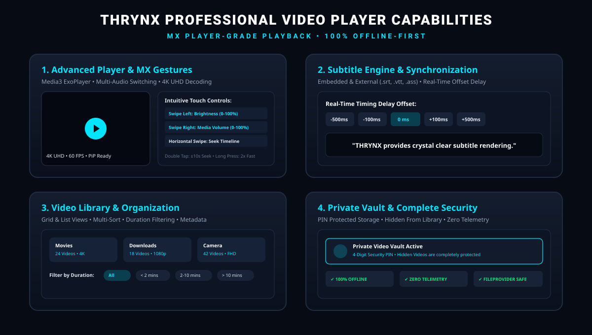

# THRYNX — All-in-One Multimedia Player, Video Editor & Creative Studio

<p align="center">
  
</p>

<p align="center">
  <a href="https://github.com/sobuj-here/thrynx/releases/latest">
    
  </a>
  
  
  
  
</p>

---

## 📥 Download & Installation

Pre-compiled production binaries for Android 8.0+ (API 26–34) are available on [GitHub Releases](https://github.com/sobuj-here/thrynx/releases/latest).

| Package | Target Architecture | File Size | Direct Download |
| :--- | :--- | :--- | :--- |
| **THRYNX v1.0.0 APK** | Universal (`arm64-v8a`, `armeabi-v7a`, `x86_64`) | ~22.1 MB | [**Download APK (`app-debug.apk`)**](https://github.com/sobuj-here/thrynx/releases/download/v1.0.0/app-debug.apk) |

### Quick Installation Steps
1. Download `app-debug.apk` directly on your device or transfer from PC.
2. Open the downloaded APK and confirm installation (allow "Install Unknown Apps" if prompted).
3. Launch **THRYNX** (`PLAY • CREATE • EDIT`).

---

## 🌟 Executive Overview
**THRYNX** is an independent, professional native Android multimedia power-station and creative studio developed with modern **Kotlin**, **Jetpack Compose (Material 3)**, and **AndroidX Media3**. 

Designed as a single unified application, THRYNX combines:
1. **Advanced Multimedia Player**: Seamless video and audio playback, multi-track audio switching (English, বাংলা, Hindi, etc.), subtitle customization, gesture controls (brightness & volume swipes, double-tap seek), PiP, screen rotation, background audio mode with vinyl visualizer and lockscreen controls.
2. **CapCut-Grade Multi-Track Video Editor**: Multi-track timeline, keyframe animation, frame-accurate clip splitting/trimming/speed (0.25x–4x), transitions, and OpenGL ES color grading.
3. **Integrated Audio Studio**: Live microphone voice-over recording directly into the timeline, hardware-accelerated audio extraction from video files, volume envelopes, and audio track management.
4. **Media Library & Discovery Engine**: Unified media discovery with sorting (Date, Name, Size, Duration), duration filtering, folder browsing, SAF file import, and metadata inspection.
5. **Photo-to-Video Slideshow Maker**: Cinematic Ken Burns zoom effect, transition engine, soundtrack synchronization, and multi-ratio exports.
6. **Project Management System**: Room SQLite database persistence, auto-saving drafts, non-destructive editing, and project recovery.
7. **100% Offline-First Privacy**: No telemetry, no ads, and no cloud uploads. All media and projects stay strictly on your local device.

---

## 📸 Feature Showcase

<p align="center">
  
</p>

---

## 🚀 Key Features

### 🎬 1. Advanced Video Player
- **Multiple Embedded Audio Tracks**: Automatically detects multiple audio streams (English, বাংলা, Hindi, Original) and switches instantly via `TrackSelectionOverride` without resetting the playback timestamp or re-buffering.
- **Subtitle Styling & External Loaders**: Detects embedded subtitles and loads external `.srt` / `.vtt` files. Fully customizable font size, text color, background opacity, and time-offset delay.
- **Intuitive Gesture Controls**:
  - Vertical swipe on left side: Screen brightness control
  - Vertical swipe on right side: Media volume control
  - Double-tap left / right: Fast ±10-second seek
  - Pinch-to-zoom & pan
- **Audio-Only Background Mode**: Turns off video decoding to listen to video audio in the background or with the screen turned off.
- **Picture-in-Picture (PiP)**: Smooth system PiP mode for multitasking.
- **Playback Position Memory**: Automatic resume prompt restoring the exact position where you left off.

### ✂️ 2. CapCut-Grade Custom Video Editing Engine
- **Independent Modular Architecture**: Built from the ground up without relying on fragile wrappers:
  - `TimelineEngine`: Manages multi-track layout, frame-accurate clip splitting, in/out trimming, clip duplication, deletion, and speed factor (0.25x to 4.0x).
  - `CompositionEngine`: Real-time multi-layer compositor calculating active clips across Video, Audio, Text, and Overlay tracks.
  - `KeyframeInterpolator`: 6-degree property curves (Translation X/Y, Scale X/Y, Rotation, Opacity, Volume) along Linear, Ease-In, Ease-Out, and Bezier interpolations.
  - `EffectsEngine`: Real-time color grading (Brightness, Contrast, Saturation, Temperature, Vignette, Grayscale, Vintage Film, and Cinematic Teal) with OpenGL ES fragment shaders.
  - `TransitionEngine`: Cross Dissolve, Fade to Black, Slide Left/Right, Zoom In, Wipe, and Blur Push.
  - `Undo/Redo History Stack`: Full state recovery for every editing action.
  - **Bangla & English Typography**: Native text layers with full support for Bengali unicode characters without text clipping.

### 📂 3. Media Library & Discovery Engine
- **Universal Media Discovery**: Automatically discovers videos and audio across accessible storage with thumbnail caching and metadata extraction.
- **Multi-Factor Sorting & Filtering**: Sort by Date, Name (A-Z), File Size, and Duration; filter by duration categories (< 2m, 2–10m, > 10m).
- **Folder Navigation**: Intuitive folder view grouping media by directory with instant drill-down.
- **Storage Access Framework (SAF) Import**: Import any video, audio, or subtitle file on your device with full metadata resolution.
- **Metadata Inspector**: Detailed inspection dialog showing resolution, duration, bitrate, file size, codec format, and exact file path.

### 🎙️ 4. Integrated Audio Studio & Extraction
- **Timeline Voice-Over Recording**: Record microphone narration directly onto the editing timeline with live elapsed timer.
- **Hardware-Accelerated Audio Extraction**: Extract lossless audio streams from any video file using native Android `MediaExtractor` and `MediaMuxer` directly inside the editor.
- **Integrated Audio Player Experience**: Audio visualizer with animated equalizer waveform, rotating vinyl disc, shuffle, repeat, and lockscreen controls.
- **Volume Envelope & Mixing**: Multi-track volume envelopes, mute controls, and clip-level volume adjustment (0%–200%).

### 🖼️ 5. Photo-to-Video Slideshow Creator
- Multi-photo picker with slide duration sliders (1.0s to 8.0s per photo).
- **Cinematic Ken Burns Effect**: Generates dynamic camera pan-and-zoom keyframe motions.
- Canvas Aspect Ratios: **16:9 Landscape**, **9:16 Shorts/Reels**, **1:1 Square**, and **4:5 Instagram Feed**.
- One-click export or conversion into a full multi-track project.

### 🌐 6. Dual-Language Localization (English & বাংলা)
- Complete language parity across all menus, buttons, dialogs, error messages, and player controls.
- Dynamic runtime language switching from Settings without restarting playback or losing project progress.

---

## 🛠️ Technology Stack & Architecture

```
com.thrynx.app
├── core/
│   ├── model/         # Domain entities, Timeline clips, Keyframes, Export config
│   ├── database/      # SQLite Room database v2 (Projects, ExportHistory, Downloads)
│   ├── datastore/     # Jetpack DataStore Preferences
│   ├── localization/  # Dynamic Locale Context Wrapper (LocaleHelper)
│   ├── player/        # Media3 ExoPlayer Engine & Track Selector
│   ├── service/       # MediaSessionService, Notifications & Lockscreen
│   ├── editor/        # Custom Editing Engine (Timeline, Composition, Shaders, Keyframes)
│   │   └── export/    # Media3 Transformer Export Engine, Compiler & Verifier
│   ├── media/         # MediaStore Scanner & AudioExtractor
│   ├── download/      # Background Download Manager Service
│   └── designsystem/  # Modern Obsidian/Cyan Theme & Design System Tokens
├── feature/           # 12 Modules (Home, Player, Editor, Library, Online, Slideshow, etc.)
└── ui/navigation/     # Jetpack Compose Navigation Graph & Mini-Player
```

- **Kotlin**: 1.9.22
- **Jetpack Compose**: Compose BOM 2024.02.00, Material 3
- **Media Engine**: AndroidX Media3 ExoPlayer & Transformer 1.2.1
- **Persistence**: Room SQLite 2.6.1 (Schema v2) & DataStore Preferences 1.0.0
- **Rendering**: Media3 Composition, OpenGL ES 2.0 Shaders & Hardware MediaCodec H.264/AAC

---

## 📦 Build From Source

```bash
# Clone repository
git clone https://github.com/sobuj-here/thrynx.git
cd thrynx

# Run Automated Unit Tests (All Test Suites Passed)
.\gradlew.bat testDebugUnitTest

# Assemble Debug APK
.\gradlew.bat assembleDebug

# Output APK is located at:
# app/build/outputs/apk/debug/app-debug.apk

# Install to connected device / emulator
.\gradlew.bat installDebug
```

---

## 🧪 Automated Test Verification
THRYNX includes verified JUnit test suites testing core editing mathematics and export pipelines:
- `TimelineEngineTest`: Verifies clip trimming, splitting at playhead, snap movements, duplication, deletion, and undo/redo stacks.
- `KeyframeAndCompositionTest`: Verifies linear and bezier keyframe interpolations, volume curves, transition states, and multi-track compositing.
- `ExportEngineTest`: Verifies export configurations (480p–1080p, 24–60fps, bitrate presets), timeline compilation into Media3 sequences, error handling, and output metadata verification.

---

## 🔒 Privacy & Local-First Commitment
- **100% Offline-First**: All video playback, timeline editing, audio mixing, and video rendering happen strictly on your local device.
- **Zero AI / Cloud Dependencies**: No remote servers or AI LLM backends required for creative workflows.
- **No Trackers**: Zero telemetry, analytics SDKs, or third-party ad networks.
- **Authorized Online Integrations**: YouTube and Facebook features use official platform handoffs and authorized embedded web views.

---

## 📄 License & Credits
Developed by **Sobuj** • © 2026 THRYNX Studio. All rights reserved.
Licensed under the [Apache License 2.0](LICENSE).
